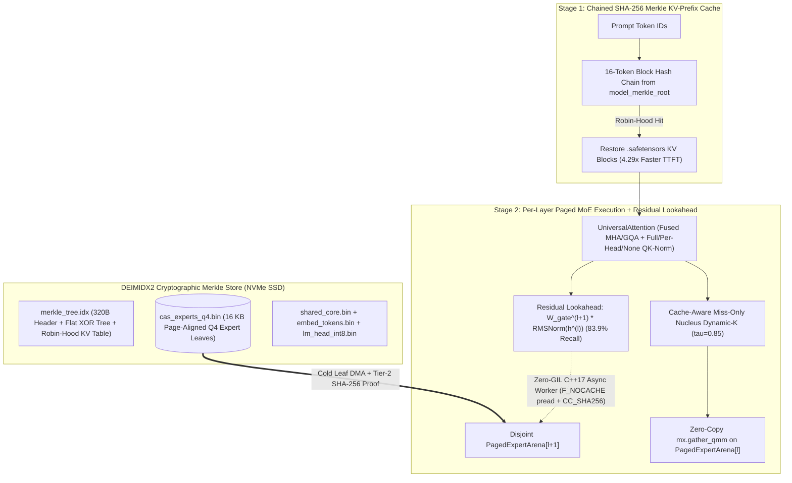

#  DeimosStream

[](https://pypi.org/project/deimos-stream/)
[](https://github.com/martianacademy/deimos-stream/actions/workflows/ci.yml)
[](https://github.com/martianacademy/phobos-stream)
[](https://github.com/martianacademy/deimos-stream)
[](https://www.python.org/)
[](https://github.com/martianacademy/deimos-stream/blob/main/LICENSE)

**DeimosStream** is a universal low-VRAM **Sparse Mixture-of-Experts (MoE) LLM streaming engine** — the language-model twin to [**PhobosStream**](https://github.com/martianacademy/phobos-stream) — built to run large Sparse MoE models (**`OLMoE`**, **`Qwen2/3-MoE`**, **`Mixtral`**, **`DeepSeek-MoE`**) inside a tiny, strictly bounded GPU memory footprint with **cryptographic Merkle proof verification** on every cold expert page streamed from NVMe SSD.

By combining a **16 KB Page-Aligned 4-Bit Cryptographic Merkle Store (`DEIMIDX2`)**, a **Pre-Allocated Unified-Memory `PagedExpertArena`** (`mx.gather_qmm`), **Zero-GIL C++17 Cross-Layer Residual Lookahead**, and **Cache-Aware Miss-Only Nucleus Dynamic-K**, DeimosStream cuts Peak Metal GPU Memory on a real **13.20 GiB (`6.92B`) Sparse MoE model from `13,613.4 MiB` down to `1,086.8–1,518.8 MiB` (`88.8%–92.0%` VRAM reduction)** while sustaining **`45.5–57.4 tok/s`** with **zero prefill VRAM spikes** and **no perplexity degradation**.

---

## 📊 Verified Empirical Benchmarks (`OLMoE-1B-7B`, 6.92B Params / 13.20 GiB FP16)

*Measured end-to-end on Apple Silicon (`M4 Max` Metal GPU, real `F_NOCACHE` random NVMe `pread` measured at `2.03–2.96 GiB/s`) on `allenai/OLMoE-1B-7B-0125-Instruct` (`16 layers × 64 experts = 1,024` SwiGLU experts, `Top-8` active per token):*

| Execution Mode | Active / Peak Metal VRAM | Peak VRAM Saved | Process RSS | Expert Cache Hit Rate | Decode Speed | Held-Out Quality (PPL ↓) |
| :--- | :---: | :---: | :---: | :---: | :---: | :--- |
| **1. Monolithic FP16 Baseline** *(All weights in GPU)* | `13,261.5` / **13,613.4 MiB** | `0.0%` | `13,680+ MiB` | `100.0%` *(Pinned)* | `142.24 tok/s` | `6.4182` *(FP16 Ref)* |
| **2. Naive On-Demand FP16 Streaming** *(`mx.stack`)* | `1,709.4` / **4,567.9 MiB** *(+2.85 GiB spike)* | `66.4%` | `~4,600 MiB` | `19.0%` | `4.71 tok/s` | `6.4182` |
| **3. DeimosStream Full-Pinned Q4 (`--slots 64`)** | `4,108.8` / **4,154.5 MiB** | **`69.5%`** | `~4,220 MiB` | `100.0%` *(Pinned)* | **251.48 tok/s** *(1.77x)* | **6.2229** |
| **4. DeimosStream Low-VRAM Champion (`--slots 16 --tau 0.85`)** | `1,516.8` / **1,518.8 MiB** *(0 spike)* | **`88.8%`** | **1,309.8 MiB** | **92.2%–93.3%** | **55.62 tok/s** *(57.4 @ τ=0.78)* | **6.2285** |
| **5. DeimosStream Ultra-Low `1.06 GiB` (`--slots 8 --tau 0.85`)** | `1,084.8` / **1,086.8 MiB** *(0 spike)* | **`92.0%`** | **881.7 MiB** | **88.4%** | **45.53 tok/s** | **6.2541** *(0.0 diff @ τ=1.0)* |

* **Bit-Exact Streaming Guarantee (`--tau 1.0`)**: Running `DeimosPagedMoEEngine(..., slots_per_layer=8, miss_tail_tau=1.0)` produces **`0.00000000` (`0.0`) maximum logit difference** and **100% identical greedy tokens** against Full-64-Slot Pinned Q4 despite continuous LFU+LRU page evictions.
* **Warm Multi-Turn Merkle KV-Prefix Cache**: Across full process restarts on a 54-token prompt, `MerkleKVPrefixCache` verifies and restores `48/54` cached prompt tokens in `O(1)` via `DEIMIDX2` Robin-Hood hashing, cutting cold-restart TTFT **`4.29x` (`1,014.5 ms -> 236.4 ms`)** with exact output parity.

---

## 🏛️ System Architecture



### Core Architectural Mechanisms

1. **Universal `DEIMIDX2` Cryptographic Merkle Index (`deimos_merkle.mm`)**:
   - Supports arbitrary `(num_layers, num_experts, vocab_size)` topologies (non-power-of-2 leaf counts automatically padded to `tree_leaf_cap = 2^⌈log2(L·E)⌉`).
   - **Tier-1 Startup Proof**: Verifies all leaf-to-root XOR sibling paths and the 4-branch `model_merkle_root` (`embedding || shared_core || expert_tree || lm_head`) in **`2.08 ms`** (`3.1 ns` `O(1)` C-struct lookup).
   - **Tier-2 Cold Leaf Proof**: Hardware-accelerated ARMv8 `CC_SHA256` verifies every cold expert's raw 4-bit payload bytes on NVMe `pread`/`mmap` before weights enter GPU memory, raising `DeimosMerkleIntegrityError` on even a **1-bit disk flip**.
2. **Pre-Allocated Unified-Memory `PagedExpertArena` (`deimos_arena.mm`)**:
   - Eliminates `mx.stack` allocation spikes by pre-allocating a fixed `[C, ...]` Q4 tensor pool per layer in Apple Silicon Unified Memory.
   - Cache hits execute directly in-place via `mx.gather_qmm(..., rhs_indices=phys_slots)` with **zero intermediate tensor copies**; cache misses overwrite the LFU+LRU victim slot in-place via zero-GIL C++17 `memcpy` + `POSIX_MADV_DONTNEED`.
3. **Cross-Layer Residual Lookahead (`83.91%` Top-8 Recall)**:
   - Exploits residual stream continuity ($h^{(l+1)} = h^{(l)} + \Delta_{\text{MoE}}^{(l)} + \Delta_{\text{Attn}}^{(l+1)}$): predicts Layer `l+1` experts using $W_{\text{gate}}^{(l+1)} \cdot \text{RMSNorm}(h_{\text{post-attn}}^{(l)})$ and stages cold `l+1` leaves on a background C++17 worker thread into **disjoint `arena[l+1]`** while the Metal GPU computes `MoE(l)` and `Attention(l+1)` — eliminating **83.6% of synchronous SSD misses** with zero race conditions.
4. **Cache-Aware Miss-Only Nucleus Dynamic-K (`--tau`)**:
   - Never drops experts already resident in GPU VRAM (since cache hits cost `<0.05 ms` on Metal). Only skips **low-weight tail SSD misses** beyond `min_k` once cumulative routing mass reaches $\tau$ (`0.85`), rescaling kept weights to preserve layer activation norm.

---

## 📐 Scaling Envelope & Honest Hardware Scope

Why Sparse MoE streaming achieves `45–57 tok/s` while dense weight streaming cannot:
* A **dense** model touches **100%** of its parameters on every single token (`e.g. 14 GB / 3 GB/s ≈ 0.2 tok/s` physics ceiling).
* A **Sparse MoE** activates only **$k / E$ (`3%–12.5%`)** of expert parameters per token, exhibits strong conversational topic locality (`88%–93%` hit rate in a `12.5%–25%` slot arena), and exposes cross-layer residual predictability (`~84%` lookahead recall).

| Sparse MoE Model Class | Original FP16 Size | Q4 `DEIMIDX2` Disk Store | Active Backbone + KV | Paged Arena (`16–25%` Slots) | Total GPU VRAM Needed |
| :--- | :---: | :---: | :---: | :---: | :---: |
| **`OLMoE-1B-7B` (6.9B, A1.3B)** *(Verified)* | `13.2 GiB` | `3.38 GiB` | `~0.65 GiB` | `0.43–0.86 GiB` (`8–16/64`) | **`1.08 – 1.52 GiB`** |
| **`Qwen3-30B-A3B` (30.5B, 128E Top-8)** | `~61 GiB` | `~15.5 GiB` | `~1.6 GiB` | `~2.4 GiB` (`20/128`) | **`~4.0 – 4.5 GiB`** *(8 GB Mac)* |
| **`Mixtral-8x7B` (46.7B, 8E Top-2)** | `~93 GiB` | `~23.5 GiB` | `~2.1 GiB` | `~3.8 GiB` (`2–3/8`) | **`~5.8 – 6.5 GiB`** *(8–16 GB Mac)* |
| **`Qwen3-235B-A22B` (235B, 128E Top-8)** | `~470 GiB` | `~118 GiB` | `~8.5 GiB` | `~11.5 GiB` (`16/128`) | **`~20 – 22 GiB`** *(24–32 GB Mac)* |

*(Note: `OLMoE-1B-7B` figures are live hardware measurements on M4 Max; larger rows show analytical `DEIMIDX2` Q4 memory footprints from exact tensor dimensions.)*

---

## ⚡ Quick Start

### 1. Install (`PyPI` — Apple Silicon `MLX` or Linux/Cloud `CUDA`)

```bash
# macOS Apple Silicon (uses native MLX Metal gather_qmm + zero-copy Unified Memory):
pip install deimos-stream

# Linux / Cloud NVIDIA CUDA GPUs (installs PyTorch pinned-DMA + FlashAttention SDPA backend):
pip install "deimos-stream[cuda]"
```

Or install from source for development:
```bash
git clone https://github.com/martianacademy/deimos-stream.git
cd deimos-stream
uv venv --python 3.12 && source .venv/bin/activate
uv pip install -e ".[cuda,dev]"
pytest -v
```
*(Hardware routing `--backend auto`: on Apple Silicon, DeimosStream always selects native **`mlx`** rather than `mps` for zero-copy Unified-Memory pointers and fused 4-bit `mx.gather_qmm` Metal kernels; on Linux/Windows with NVIDIA/ROCm GPUs, it selects **`cuda`** with `pin_memory=True` async PCIe stream DMA and ABA-safe `slot_gen` slot synchronization over the exact same `DEIMIDX2` Merkle store.)*

### 2. Convert Any `.safetensors` Sparse MoE Checkpoint & Stream Chat

Supports HuggingFace & MLX `.safetensors` checkpoints across **`OLMoE`**, **`Qwen2-MoE` / `Qwen3-MoE`** (including GQA, per-head QK-Norm, and `shared_expert`), **`Mixtral`** (`w1/w2/w3`), and **`DeepSeek-MoE`**:

```bash
# 1. Convert a .safetensors Sparse MoE checkpoint into a 16 KB page-aligned DEIMIDX2 Q4 store:
deimos-stream convert \
  --model-dir /path/to/OLMoE-1B-7B-0125-Instruct \
  --output-dir ./olmoe_deimos_q4

# 2. Cryptographically verify the Tier-1 XOR Merkle tree & all Tier-2 SHA-256 expert leaves:
deimos-stream inspect --store-dir ./olmoe_deimos_q4 --verify-leaves

# 3. Launch interactive Low-VRAM streaming chat (1.52 GiB VRAM @ ~56 tok/s):
deimos-stream chat --store-dir ./olmoe_deimos_q4 --slots 16 --tau 0.85

# Ultra-Low 1.08 GiB VRAM mode (8 slots/layer):
deimos-stream chat --store-dir ./olmoe_deimos_q4 --slots 8 --tau 0.85
```

Inside interactive `deimos-stream chat`, switch VRAM budgets and routing thresholds live:
* `/slots <8|16|32|64>` — hot-rebuild `PagedExpertArena` capacity on the fly
* `/tau <0.50..1.00>` — adjust Miss-Only Nucleus Dynamic-K (`1.00` = bit-exact Top-K)
* `/lookahead <on|off>` — toggle C++17 cross-layer Residual Lookahead prefetch

### 3. OpenAI-Compatible API Gateway (`deimos-stream serve`)

Expose any `DEIMIDX2` Sparse MoE store as a local OpenAI `/v1/chat/completions` server (streaming SSE + JSON, compatible with the `openai` SDK, Cursor, Continue, OpenCode, and OpenWebUI):

```bash
deimos-stream serve \
  --store-dir ./olmoe_deimos_q4 \
  --host 127.0.0.1 \
  --port 8080 \
  --slots 16 \
  --tau 0.85 \
  --model-name olmoe-1b-7b-q4
```

```bash
curl http://127.0.0.1:8080/v1/chat/completions \
  -H "Content-Type: application/json" \
  -d '{
    "model": "olmoe-1b-7b-q4",
    "stream": true,
    "max_tokens": 128,
    "messages": [{"role": "user", "content": "Explain Merkle trees in two sentences."}]
  }'
```

### 4. Python API (`DeimosPagedMoEEngine`)

```python
from pathlib import Path
from deimos_stream import DeimosPagedMoEEngine, convert_safetensors_moe_to_deimos_q4

# One-time conversion from HuggingFace / MLX .safetensors:
store_dir = convert_safetensors_moe_to_deimos_q4(
    source_model_dir=Path("/path/to/moe-checkpoint"),
    output_store_dir=Path("./moe_deimos_q4"),
)

# Run inside a fixed 16-slot/layer Unified-Memory Arena:
engine = DeimosPagedMoEEngine(
    store_dir=store_dir,
    slots_per_layer=16,
    use_nocache_pread=True,
    enable_lookahead=True,
    miss_tail_tau=0.85,  # Set 1.0 for bit-exact parity vs full-pinned Q4
)
try:
    metrics = engine.benchmark_generation(
        "<|user|>\nExplain Merkle trees in two sentences.\n<|assistant|>\n",
        max_new_tokens=64,
    )
    print(metrics["generated_text"])
    print(f"Peak VRAM: {metrics['peak_vram_mb']} MiB | Speed: {metrics['decode_tok_per_s']} tok/s")
finally:
    engine.close()
```

---

## 🌌 Martian Academy Streaming Suite

* [**PhobosStream**](https://github.com/martianacademy/phobos-stream) — Universal Zero-VRAM **Video & Image Diffusion (`DiT`)** Streaming Engine (`Wan2.1`, `FLUX.1`, `HunyuanVideo`, `Z-Image-Turbo` • `93.9%–95.3%` VRAM saved).
* [**DeimosStream**](https://github.com/martianacademy/deimos-stream) — Universal Low-VRAM **Sparse MoE & LLM** Merkle-Paged Streaming Engine (`OLMoE`, `Qwen2/3-MoE`, `Mixtral`, `DeepSeek-MoE` • `88.8%–92.0%` VRAM saved).

---

## 📜 License

[MIT License](https://github.com/martianacademy/deimos-stream/blob/main/LICENSE) — free for commercial and personal use.
