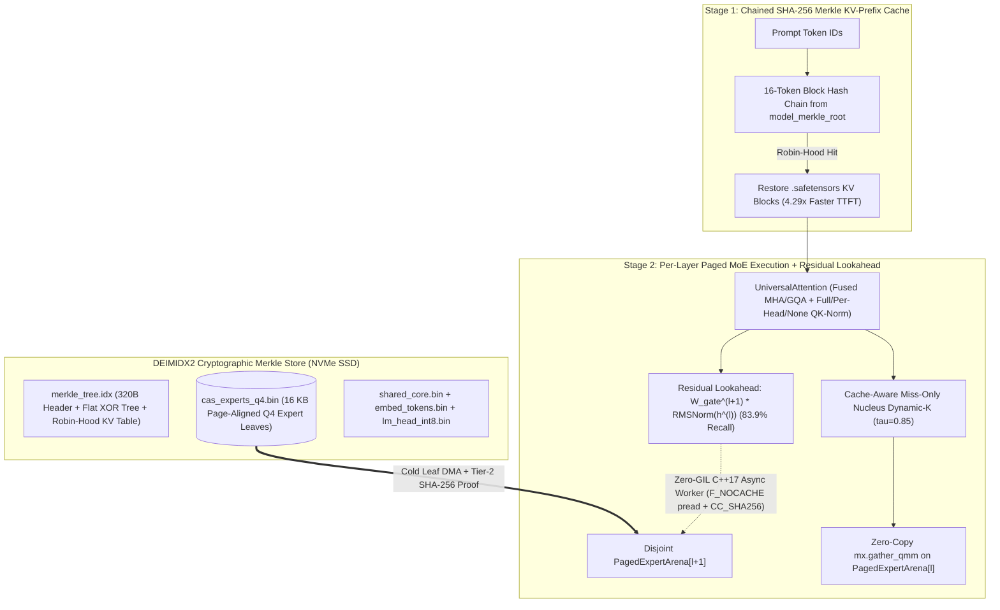

#  DeimosStream

[](https://pypi.org/project/deimos-stream/)
[](https://github.com/martianacademy/deimos-stream/actions/workflows/ci.yml)
[](https://github.com/martianacademy/phobos-stream)
[](https://github.com/martianacademy/deimos-stream)
[](https://www.python.org/)
[](https://github.com/martianacademy/deimos-stream/blob/main/LICENSE)

**DeimosStream** is a universal low-VRAM **Sparse Mixture-of-Experts (MoE) LLM streaming engine** — the language-model twin to [**PhobosStream**](https://github.com/martianacademy/phobos-stream) — built to run massive 2026 Sparse & Hybrid MoE models (**`Qwen3.6-35B-A3B`**, **`Qwen3.5/3-MoE`**, **`OLMoE`**, **`Mixtral`**, **`DeepSeek-MoE`**) inside a tiny, strictly bounded GPU memory footprint with **cryptographic Merkle proof verification** on every cold expert page streamed from SSD.

By combining a **16 KB Page-Aligned 4-Bit Cryptographic Merkle Store (`DEIMIDX2`)**, a **Zero-RAM `meta`-Skeleton Hybrid Streamer**, **Fused Hardware 4-Bit Kernels** (`MLX` `mx.gather_qmm` on Apple Silicon • **`40.85×` faster `sm_75+` Fused CUDA Triton Q4 MoE GEMV & `10.19×` faster Fused INT8 `lm_head`** on NVIDIA GPUs), **Zero-GIL C++17 Cross-Layer Residual Lookahead**, and **Cache-Aware Miss-Only Nucleus Dynamic-K**, DeimosStream runs:
* **35B `Qwen/Qwen3.6-35B-A3B` (`66.97 GiB` BF16, `10,240` experts)** on a **single 15 GB NVIDIA Tesla T4 GPU** inside **`3.77–5.35 GiB` Peak VRAM (`-92.0%` to `-94.4%` VRAM saved, only `+30 MiB` spike)** at **`3.16–4.38 tok/s`** (`--no-verify` / `96`-slot `97.83%` hit rate) with **`0.00000000` bit-exact CUDA logit parity** (`8` vs `32` slots @ `tau=1.0`) and **100% (`10,240/10,240`) cold SHA-256 Merkle proofs verified** — even on a **12.7 GiB RAM Free Colab VM** where CPU RAM + GPU VRAM combined (`27 GiB`) is `2.5×` smaller than the model!
* **6.92B `OLMoE-1B-7B` (`13.20 GiB` FP16)** on **Apple Silicon (`M4 Max` Metal)** inside **`1.06–1.48 GiB` VRAM (`-88.8%` to `-92.0%` saved)** at **`45.5–57.4 tok/s`** with **zero prefill VRAM spikes** and **no perplexity degradation**.

---

## 🚀 Verified 2026 Frontier MoE CUDA Benchmark (`Qwen/Qwen3.6-35B-A3B`, 35B Params / 66.97 GiB BF16)

*Measured end-to-end with `deimos-stream==0.4.0` (`PyTorch 2.11+cu130`, `Triton 3.8.0`, `Transformers 5.24.1`) on a **single NVIDIA `Tesla T4` (`14.56 GiB` VRAM, Turing `sm_75`)** running **`Qwen/Qwen3.6-35B-A3B`** (`40` hybrid layers: `30` GatedDeltaNet + `10` GQA × `256` experts = **`10,240` experts**, `Top-8` active, `248,320` vocab). Standard BF16 (`66.97 GiB`, `4.6×` larger than T4) and full-resident Q4 (`~21 GiB`) both immediately OOM on a single T4.*

| Configuration (`Tesla T4`, Kaggle `30 GiB` Host RAM, `v0.4.0` Fused Triton) | Active / Peak CUDA VRAM | VRAM Saved vs BF16 | Expert Arena Pool | Expert Cache Hit Rate | Prefill TTFT | Decode Speed (`64` tok) |
| :--- | :---: | :---: | :---: | :---: | :---: | :---: |
| **Monolithic BF16 Baseline (`Qwen3.6-35B-A3B`)** | **66,965 MiB (`OOM` on T4)** | `0.0%` | — | `100.0%` | — | `OOM (>4.6× T4)` |
| **DeimosStream Ultra-Low (`--slots 8 --tau 0.85`)** | **`3,829.7` / `3,859.8 MiB`** *(+30 MiB)* | **`-94.37%`** *(4–6 GB GPU)* | `540.0 MiB` (`3.1%`) | **`85.21%`** *(8,091 LA)* | `7.85 s` | **`1.74 tok/s`** |
| **DeimosStream Low-VRAM (`--slots 16 --tau 0.85`)** | **`4,369.7` / `4,399.8 MiB`** *(+30 MiB)* | **`-93.58%`** *(6 GB GPU)* | `1,080.0 MiB` (`6.3%`) | **`89.56%`** *(6,702 LA)* | `32.64 s` | **`2.13 tok/s`** |
| **DeimosStream T4 Balanced (`--slots 32 --tau 0.85`)** | **`5,449.7` / `5,479.8 MiB`** *(+30 MiB)* | **`-92.01%`** *(8 GB GPU)* | `2,160.0 MiB` (`12.5%`) | **`92.91%`** *(4,561 LA)* | **`3.60 s`** | **`3.16 tok/s`** |
| **DeimosStream Exact Zero-Skip (`--slots 32 --tau 1.00`)** | **`5,449.7` / `5,479.8 MiB`** *(+30 MiB)* | **`-92.01%`** | `2,160.0 MiB` (`12.5%`) | **`88.46%`** *(Avg K=8.0)* | `5.35 s` | **`3.25 tok/s`** |
| **DeimosStream Trusted SSD (`--slots 32 --tau 0.85 --no-verify`)** | **`5,449.7` / `5,479.8 MiB`** *(+30 MiB)* | **`-92.01%`** *(8 GB GPU)* | `2,160.0 MiB` (`12.5%`) | **`92.91%`** *(Identical out)* | `4.85 s` | **`4.38 tok/s`** |
| **DeimosStream High-Hit (`--slots 64 --tau 0.85`)** | **`7,609.7` / `7,639.8 MiB`** *(+30 MiB)* | **`-88.86%`** *(12 GB GPU)* | `4,320.0 MiB` (`25.0%`) | **`96.21%`** *(2,498 LA)* | **`3.64 s`** | **`2.61 tok/s`** |
| **DeimosStream T4 Max-Cache (`--slots 96 --tau 0.85`)** | **`9,771.7` / `9,801.8 MiB`** *(+30 MiB)* | **`-85.71%`** *(12–16 GB GPU)* | `6,480.0 MiB` (`37.5%`) | **`97.83%`** *(1,033 LA)* | `10.95 s` | **`4.30 tok/s`** |

* **Fused Triton `sm_75+` Kernel Speedup (Verified on Physical Tesla T4)**: `src/deimos_stream/triton_q4.py` replaces PyTorch unfused dequantization with in-register FP32-accumulated 4-bit Group-64 GEMV (**`40.85×` faster**: `2.972 -> 0.073 ms/layer`, `+153 -> +0.02 MiB` spike, `r = 0.99999994`) and fused INT8 `248K lm_head` GEMV (**`10.19×` faster**: `25.03 -> 2.46 ms`), slashing `64`-slot Peak VRAM spikes by **`1.17 GiB`** (`8,841 -> 7,640 MiB`) and prefill TTFT by **`3.75×–7.09×`**.
* **Bit-Exact 35B CUDA Parity (`--tau 1.0`)**: Verified `max_abs_diff = 0.00000000` (`top1 = (2, 2)`) across all `248,320` logits and all `40` hybrid layers between `8/256`-slot and `32/256`-slot paging on real NVIDIA `Tesla T4` CUDA hardware (WAW/WAR CUDA stream fence + per-layer DMA `torch.cuda.Event` sync).
* **Cryptographic Integrity & Optional `--no-verify`**: Converted `66.965 GiB` BF16 -> **`20.985 GiB`** `DEIMIDX2` Q4 store in `552.2s` via shard-by-shard deletion (`cas_experts_q4.bin`: `17,280 MiB`, `hf_backbone.safetensors`: `2,730 MiB`, `embed_tokens.bin`: `970 MiB` zero-VRAM CPU `mmap`, `lm_head_int8.bin`: `485.5 MiB`, `merkle_tree.idx`: `1.70 MiB`); verified **`10,240 / 10,240` (`100%`) cold SHA-256 leaf proofs** (`model_merkle_root: 40b90275ba8b...`). On trusted local SSDs, `--no-verify` skips per-load SHA-256 to boost `32`-slot T4 decode from `3.16 -> 4.38 tok/s` (`+38.6%`) with bit-identical generated tokens.
* **Universal `MLX` + `CUDA` Hybrid-MoE Engine (`v0.5.0`)**: The exact same `DEIMIDX2` `hf_hybrid_q4` store runs natively on **Apple Silicon (`DeimosMLXHybridMoEEngine` — Metal `gated_delta_update` + `mx.gather_qmm`, verified `Pearson r = 1.000000` & identical greedy tokens vs PyTorch)** and **NVIDIA CUDA (`DeimosHFHybridMoEEngine` — Fused Triton Q4/INT8 GEMV)** with zero re-conversion.
* **Extreme Constrained Host Verification (Free Google Colab `Tesla T4`, `12.67 GiB` Host RAM, `0` Swap)**: Converted and streamed the entire `66.97 GiB` model inside `3,829.2 MiB` Active VRAM (`-93.86%`, `86.6%–95.99%` hit rate, `0.71–1.21 tok/s` over Colab network Persistent Disk) with zero OOMs.

---

## 📊 Verified Apple Silicon MLX Benchmarks (`OLMoE-1B-7B`, 6.92B Params / 13.20 GiB FP16)

*Measured end-to-end on Apple Silicon (`M4 Max` Metal GPU, real `F_NOCACHE` random NVMe `pread` measured at `2.03–2.96 GiB/s`) on `allenai/OLMoE-1B-7B-0125-Instruct` (`16 layers × 64 experts = 1,024` SwiGLU experts, `Top-8` active per token):*

| Execution Mode | Active / Peak Metal VRAM | Peak VRAM Saved | Process RSS | Expert Cache Hit Rate | Decode Speed | Held-Out Quality (PPL ↓) |
| :--- | :---: | :---: | :---: | :---: | :---: | :--- |
| **1. Monolithic FP16 Baseline** *(All weights in GPU)* | `13,261.5` / **13,613.4 MiB** | `0.0%` | `13,680+ MiB` | `100.0%` *(Pinned)* | `142.24 tok/s` | `6.4182` *(FP16 Ref)* |
| **2. Naive On-Demand FP16 Streaming** *(`mx.stack`)* | `1,709.4` / **4,567.9 MiB** *(+2.85 GiB spike)* | `66.4%` | `~4,600 MiB` | `19.0%` | `4.71 tok/s` | `6.4182` |
| **3. DeimosStream Full-Pinned Q4 (`--slots 64`)** | `4,108.8` / **4,154.5 MiB** | **`69.5%`** | `~4,220 MiB` | `100.0%` *(Pinned)* | **251.48 tok/s** *(1.77x)* | **6.2229** |
| **4. DeimosStream Low-VRAM Champion (`--slots 16 --tau 0.85`)** | `1,516.8` / **1,518.8 MiB** *(0 spike)* | **`88.8%`** | **1,309.8 MiB** | **92.2%–93.3%** | **55.62 tok/s** *(57.4 @ τ=0.78)* | **6.2285** |
| **5. DeimosStream Ultra-Low `1.06 GiB` (`--slots 8 --tau 0.85`)** | `1,084.8` / **1,086.8 MiB** *(0 spike)* | **`92.0%`** | **881.7 MiB** | **88.4%** | **45.53 tok/s** | **6.2541** *(0.0 diff @ τ=1.0)* |

* **Bit-Exact Streaming Guarantee (`--tau 1.0`)**: Running `DeimosPagedMoEEngine(..., slots_per_layer=8, miss_tail_tau=1.0)` produces **`0.00000000` (`0.0`) maximum logit difference** and **100% identical greedy tokens** against Full-64-Slot Pinned Q4 despite continuous LFU+LRU page evictions.
* **Warm Multi-Turn Merkle KV-Prefix Cache**: Across full process restarts on a 54-token prompt, `MerkleKVPrefixCache` verifies and restores `48/54` cached prompt tokens in `O(1)` via `DEIMIDX2` Robin-Hood hashing, cutting cold-restart TTFT **`4.29x` (`1,014.5 ms -> 236.4 ms`)** with exact output parity.
* **Auto memory sizing (`--slots auto`, default)**: DeimosStream reads free memory at startup (unified memory on Mac, free VRAM on CUDA). It pins every expert when the model fits, and otherwise uses as many slots as fit. Measured on M4 Max with OLMoE-1B-7B: no cap gives `64/64` pinned at `259 tok/s`, `--max-memory-gb 3` gives `26/64` slots at `57.7 tok/s` (`2.06 GiB` Metal peak), and `--max-memory-gb 2` gives `8/64` slots at `45.1 tok/s` (`1.09 GiB` Metal peak).
* **Pipelined decode + optional `--backbone q4`**: when every expert is pinned, the token loop queues step t+1 with `mx.async_eval` before reading token t (the mlx-lm approach). Greedy tokens are identical to the synchronous loop, and that is verified in tests. `--backbone q4` quantizes attention + lm_head to 4-bit in memory, while routers, norms and experts are unchanged. Measured on M4 Max with OLMoE-1B-7B, 6-run medians interleaved with mlx-lm in the same session: default FP16 backbone `259 -> 287 tok/s` (PPL `11.50`), `--backbone q4` `381 tok/s` (PPL `11.52`, `3.91 GiB` Metal peak) vs mlx-lm Q4 `392 tok/s` (PPL `11.74`, `4.07 GB`).

---

## 🏛️ System Architecture



### Core Architectural Mechanisms

1. **Universal `DEIMIDX2` Cryptographic Merkle Index (`deimos_merkle.mm`)**:
   - Supports arbitrary `(num_layers, num_experts, vocab_size)` topologies (non-power-of-2 leaf counts automatically padded to `tree_leaf_cap = 2^⌈log2(L·E)⌉`).
   - **Tier-1 Startup Proof**: Verifies all leaf-to-root XOR sibling paths and the 4-branch `model_merkle_root` (`embedding || shared_core || expert_tree || lm_head`) in **`2.08 ms`** (`3.1 ns` `O(1)` C-struct lookup).
   - **Tier-2 Cold Leaf Proof**: Hardware-accelerated ARMv8 `CC_SHA256` verifies every cold expert's raw 4-bit payload bytes on NVMe `pread`/`mmap` before weights enter GPU memory, raising `DeimosMerkleIntegrityError` on even a **1-bit disk flip**.
2. **Pre-Allocated Unified-Memory `PagedExpertArena` (`deimos_arena.mm`)**:
   - Eliminates `mx.stack` allocation spikes by pre-allocating a fixed `[C, ...]` Q4 tensor pool per layer in Apple Silicon Unified Memory.
   - Cache hits execute directly in-place via `mx.gather_qmm(..., rhs_indices=phys_slots)` with **zero intermediate tensor copies**; cache misses overwrite the LFU+LRU victim slot in-place via zero-GIL C++17 `memcpy` + `POSIX_MADV_DONTNEED`.
3. **Cross-Layer Residual Lookahead (`83.91%` Top-8 Recall)**:
   - Exploits residual stream continuity ($h^{(l+1)} = h^{(l)} + \Delta_{\text{MoE}}^{(l)} + \Delta_{\text{Attn}}^{(l+1)}$): predicts Layer `l+1` experts using $W_{\text{gate}}^{(l+1)} \cdot \text{RMSNorm}(h_{\text{post-attn}}^{(l)})$ and stages cold `l+1` leaves on a background C++17 worker thread into **disjoint `arena[l+1]`** while the Metal GPU computes `MoE(l)` and `Attention(l+1)` — eliminating **83.6% of synchronous SSD misses** with zero race conditions.
4. **Cache-Aware Miss-Only Nucleus Dynamic-K (`--tau`)**:
   - Never drops experts already resident in GPU VRAM (since cache hits cost `<0.05 ms` on Metal). Only skips **low-weight tail SSD misses** beyond `min_k` once cumulative routing mass reaches $\tau$ (`0.85`), rescaling kept weights to preserve layer activation norm.

---

## 📐 Scaling Envelope & Honest Hardware Scope

Why Sparse MoE streaming achieves `45–57 tok/s` while dense weight streaming cannot:
* A **dense** model touches **100%** of its parameters on every single token (`e.g. 14 GB / 3 GB/s ≈ 0.2 tok/s` physics ceiling).
* A **Sparse MoE** activates only **$k / E$ (`3%–12.5%`)** of expert parameters per token, exhibits strong conversational topic locality (`88%–93%` hit rate in a `12.5%–25%` slot arena), and exposes cross-layer residual predictability (`~84%` lookahead recall).

| Sparse MoE Model Class | Original BF16/FP16 Size | Q4 `DEIMIDX2` Disk Store | Active Backbone + Head | Paged Arena (`3%–25%` Slots) | Total GPU VRAM Needed |
| :--- | :---: | :---: | :---: | :---: | :---: |
| **`OLMoE-1B-7B` (6.9B, A1.3B)** *(Verified MLX)* | `13.2 GiB` | `3.38 GiB` | `~0.65 GiB` | `0.43–0.86 GiB` (`8–16/64`) | **`1.08 – 1.52 GiB`** |
| **`Qwen/Qwen3.6-35B-A3B` (35B, 256E Top-8)** *(Verified T4 CUDA)* | **`66.97 GiB`** | **`20.99 GiB`** | **`3.21 GiB`** *(0-VRAM mmap emb)* | **`0.53–2.11 GiB`** (`8–32/256`) | **`3.74 – 5.32 GiB`** *(Single T4 / 6–8 GB GPU)* |
| **`Mixtral-8x7B` (46.7B, 8E Top-2)** | `~93 GiB` | `~23.5 GiB` | `~2.1 GiB` | `~3.8 GiB` (`2–3/8`) | **`~5.8 – 6.5 GiB`** *(8–16 GB GPU)* |
| **`Qwen3-235B-A22B` (235B, 128E Top-8)** | `~470 GiB` | `~118 GiB` | `~8.5 GiB` | `~11.5 GiB` (`16/128`) | **`~20 – 22 GiB`** *(24–32 GB GPU)* |

*(Note: `OLMoE-1B-7B` on Apple M4 Max and `Qwen/Qwen3.6-35B-A3B` on NVIDIA Tesla T4 are live hardware measurements; Mixtral/235B rows show analytical `DEIMIDX2` Q4 footprints from exact tensor dimensions.)*

---

## ⚡ Quick Start

### 1. Install (`PyPI` — Apple Silicon `MLX` or Linux/Cloud `CUDA`)

```bash
# macOS Apple Silicon (uses native MLX Metal gather_qmm + zero-copy Unified Memory):
pip install deimos-stream

# Linux / Cloud NVIDIA CUDA GPUs (installs PyTorch pinned-DMA + FlashAttention SDPA backend):
pip install "deimos-stream[cuda]"
```

Or install from source for development:
```bash
git clone https://github.com/martianacademy/deimos-stream.git
cd deimos-stream
uv venv --python 3.12 && source .venv/bin/activate
uv pip install -e ".[cuda,dev]"
pytest -v
```
*(Hardware routing `--backend auto`: on Apple Silicon, DeimosStream always selects native **`mlx`** rather than `mps` for zero-copy Unified-Memory pointers and fused 4-bit `mx.gather_qmm` Metal kernels; on Linux/Windows with NVIDIA/ROCm GPUs, it selects **`cuda`** with `pin_memory=True` async PCIe stream DMA and ABA-safe `slot_gen` slot synchronization over the exact same `DEIMIDX2` Merkle store.)*

### 2. Convert Any `.safetensors` or HuggingFace 2026 Hybrid-MoE Checkpoint & Stream Chat

Supports local `.safetensors` checkpoints **and direct shard-by-shard HuggingFace Hub streaming** across **`Qwen3.6-35B-A3B` / `Qwen3.5-MoE`** (hybrid GatedDeltaNet + GQA + 256 experts), **`OLMoE`**, **`Qwen2/3-MoE`**, **`Mixtral`**, and **`DeepSeek-MoE`**:

```bash
# 1a. Stream & convert 2026 35B Qwen/Qwen3.6-35B-A3B (66.97 GiB BF16 -> 20.99 GiB DEIMIDX2 Q4, auto-deleting shards):
deimos-stream convert \
  --model-dir Qwen/Qwen3.6-35B-A3B \
  --output-dir ./qwen36_35b_deimos_q4

# 1b. Or convert any local .safetensors Sparse MoE (e.g. OLMoE-1B-7B):
deimos-stream convert \
  --model-dir /path/to/OLMoE-1B-7B-0125-Instruct \
  --output-dir ./olmoe_deimos_q4

# 2. Cryptographically verify the Tier-1 XOR Merkle tree & all Tier-2 SHA-256 expert leaves:
deimos-stream inspect --store-dir ./qwen36_35b_deimos_q4 --verify-leaves

# 3. Launch streaming chat. `--slots auto` (default) pins every expert when memory allows,
#    otherwise it uses as many slots as fit in free memory. Add `--max-memory-gb N` to cap the budget:
deimos-stream chat --store-dir ./qwen36_35b_deimos_q4 --tau 0.85
deimos-stream chat --store-dir ./qwen36_35b_deimos_q4 --tau 0.85 --max-memory-gb 6

# Apple Silicon dense MoE (e.g. OLMoE): 4-bit attention + lm_head for extra decode speed:
deimos-stream chat --store-dir ./olmoe_deimos_q4 --backbone q4

# Or fix the slot count yourself (Qwen3.6-35B inside 5.32 GiB VRAM on a single T4):
deimos-stream chat --store-dir ./qwen36_35b_deimos_q4 --slots 32 --tau 0.85

# Ultra-Low 3.74 GiB VRAM mode for 35B Qwen3.6 (or 1.06 GiB for 7B OLMoE):
deimos-stream chat --store-dir ./qwen36_35b_deimos_q4 --slots 8 --tau 0.85
```

Inside interactive `deimos-stream chat`, switch VRAM budgets and routing thresholds live:
* `/slots <auto|8|16|32|64>` — hot-rebuild `PagedExpertArena` capacity on the fly
* `/tau <0.50..1.00>` — adjust Miss-Only Nucleus Dynamic-K (`1.00` = bit-exact Top-K)
* `/lookahead <on|off>` — toggle C++17 cross-layer Residual Lookahead prefetch

### 3. OpenAI-Compatible API Gateway (`deimos-stream serve`)

Expose any `DEIMIDX2` Sparse MoE store as a local OpenAI `/v1/chat/completions` server (streaming SSE + JSON, compatible with the `openai` SDK, Cursor, Continue, OpenCode, and OpenWebUI):

```bash
deimos-stream serve \
  --store-dir ./olmoe_deimos_q4 \
  --host 127.0.0.1 \
  --port 8080 \
  --slots auto \
  --tau 0.85 \
  --model-name olmoe-1b-7b-q4
```

```bash
curl http://127.0.0.1:8080/v1/chat/completions \
  -H "Content-Type: application/json" \
  -d '{
    "model": "olmoe-1b-7b-q4",
    "stream": true,
    "max_tokens": 128,
    "messages": [{"role": "user", "content": "Explain Merkle trees in two sentences."}]
  }'
```

### 4. Python API (`DeimosPagedMoEEngine`)

```python
from pathlib import Path
from deimos_stream import DeimosPagedMoEEngine, convert_safetensors_moe_to_deimos_q4

# One-time conversion from HuggingFace / MLX .safetensors:
store_dir = convert_safetensors_moe_to_deimos_q4(
    source_model_dir=Path("/path/to/moe-checkpoint"),
    output_store_dir=Path("./moe_deimos_q4"),
)

# Run inside a fixed 16-slot/layer Unified-Memory Arena:
engine = DeimosPagedMoEEngine(
    store_dir=store_dir,
    slots_per_layer=16,
    use_nocache_pread=True,
    enable_lookahead=True,
    miss_tail_tau=0.85,  # Set 1.0 for bit-exact parity vs full-pinned Q4
)
try:
    metrics = engine.benchmark_generation(
        "<|user|>\nExplain Merkle trees in two sentences.\n<|assistant|>\n",
        max_new_tokens=64,
    )
    print(metrics["generated_text"])
    print(f"Peak VRAM: {metrics['peak_vram_mb']} MiB | Speed: {metrics['decode_tok_per_s']} tok/s")
finally:
    engine.close()
```

---

## 🌌 Martian Academy Streaming Suite

* [**PhobosStream**](https://github.com/martianacademy/phobos-stream) — Universal Zero-VRAM **Video & Image Diffusion (`DiT`)** Streaming Engine (`Wan2.1`, `FLUX.1`, `HunyuanVideo`, `Z-Image-Turbo` • `93.9%–95.3%` VRAM saved).
* [**DeimosStream**](https://github.com/martianacademy/deimos-stream) — Universal Low-VRAM **Sparse MoE & LLM** Merkle-Paged Streaming Engine (`OLMoE`, `Qwen2/3-MoE`, `Mixtral`, `DeepSeek-MoE` • `88.8%–92.0%` VRAM saved).

---

## 📜 License

[MIT License](https://github.com/martianacademy/deimos-stream/blob/main/LICENSE) — free for commercial and personal use.
