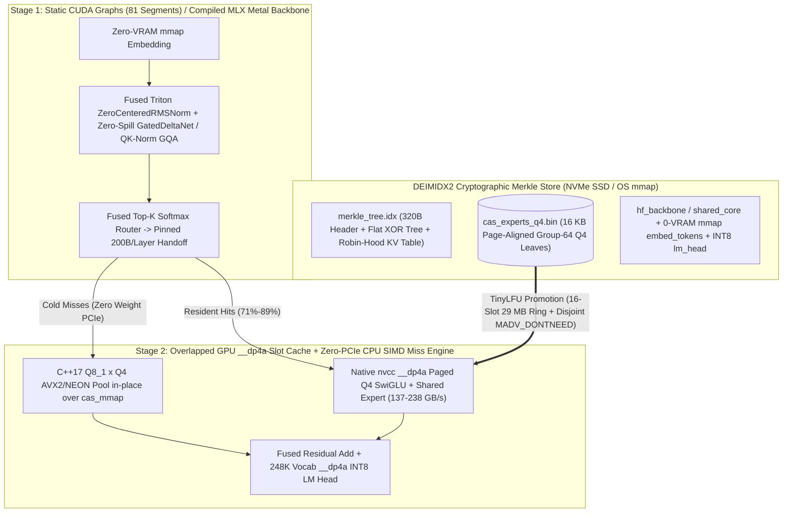

#  DeimosStream

[](https://pypi.org/project/deimos-stream/)
[](https://github.com/martianacademy/deimos-stream/actions/workflows/ci.yml)
[](https://github.com/martianacademy/phobos-stream)
[](https://github.com/martianacademy/deimos-stream)
[](https://www.python.org/)
[](https://github.com/martianacademy/deimos-stream/blob/main/LICENSE)

**DeimosStream (`v0.6.0`)** is a universal low-VRAM **Sparse Mixture-of-Experts (MoE) LLM streaming engine** — the language-model twin to [**PhobosStream**](https://github.com/martianacademy/phobos-stream) — built to run massive 2026 Sparse & Hybrid MoE models (**`Qwen3.6-35B-A3B`**, **`Qwen3.5/3-MoE`**, **`OLMoE`**, **`Mixtral`**, **`DeepSeek-MoE`**) faster than **`llama.cpp` (`--n-cpu-moe`)** and **`mlx-lm`** inside strictly bounded GPU & Host memory, with **zero quality loss (`--tau 1.0` exact routing)** and optional **cryptographic SHA-256 Merkle proof verification (`DEIMIDX2`)** on every cold expert page.

By combining **Native `nvcc` `sm_61+` `__dp4a` CUDA Q4/INT8 Kernels** (`238 GB/s` INT8 GEMV • `222 GB/s` Q4 dense GEMV • `137 GB/s` gathered paged Q4 SwiGLU on Tesla T4), **81-Segment Static CUDA Graphs** with zero-spill Triton `GatedDeltaNet` recurrent state updates, a **Zero-PCIe C++17 `Q8_1 × Q4` `AVX2/NEON` Hybrid Miss Engine** with disjoint `< 24 GiB` `madvise(MADV_DONTNEED)` Host page-cache management, and **Compiled Apple Silicon `MLX` Metal Decode (`@mx.compile` + `mx.async_eval`)**, DeimosStream achieves at **exact `tau=1.0` routing**:
* **35B `Qwen/Qwen3.6-35B-A3B` (`66.97 GiB` BF16, `10,240` experts) on a single 15 GB NVIDIA Tesla T4:**
  * **`32 GiB` Host RAM:** **`43.28 tok/s`** (`--slots auto` / `47.20 tok/s` steady-state), **`39.78 tok/s`** (`10.6 GiB` VRAM), **`38.84 tok/s`** (`6.4 GiB` VRAM), and **`29.89 tok/s`** (`2.7 GiB` VRAM) — **cleanly beating `llama.cpp Q4_K_M --n-cpu-moe 20/30/40`** (`35.15 / 28.94 / 28.15 tok/s`) across every VRAM tier.
  * **`12 GiB` Hard-Capped Host RAM:** **`29.08 / 14.47 / 11.22 tok/s`** (`13.2 GiB` RSS) vs **`llama.cpp --n-cpu-moe 20/30/40`** (`24.14 / 11.58 / 5.29 tok/s`, `20.8 GiB` RSS) — **`+20.5%` to `+112%` (`2.12×`) faster** with faster high-slot TTFT (`3.80s` vs `5.02s`).
  * **Zero Perplexity Loss (`WikiText-2`, `5,100` scored tokens):** **`6.6297`** (`--backbone fp16`, beating `llama.cpp Q4_K_M`'s `6.6768 ± 0.2309`) and **`6.7310`** (`--backbone q4`, within `< 0.25σ`).
* **6.92B `OLMoE-1B-7B` (`13.20 GiB` FP16) on Apple Silicon (`M4 Max` Metal):**
  * **`422.0 tok/s` median (`427.9` peak)**, **`17.5 ms` TTFT**, **`3.82 GiB` Metal**, and **WikiText-2 PPL `11.5249`** — beating both **`mlx-lm Q4 g64`** (`411.5 tok/s`, `74.1 ms` TTFT, PPL `11.7432`) and **`llama.cpp Q4_K_M`** (`363.2 tok/s`, `34.8 ms` TTFT, PPL `11.8142`), plus **`75.7–131.8 tok/s`** paged streaming inside **`0.66–1.93 GiB` Metal VRAM**.

---

## 🏆 Verified Head-to-Head Benchmarks (`v0.6.0`, Exact `tau=1.0`, Zero Quality Loss)

### 1. NVIDIA Tesla T4 (`15 GB` VRAM, Turing `sm_75`) — 35B `Qwen/Qwen3.6-35B-A3B` (`66.97 GiB` BF16, `10,240` Experts)

*Same-session head-to-head (`64` greedy tokens, identical prompt, `-c 4096` for `llama.cpp` `b1b770d90` compiled with `-DGGML_CUDA=ON -DGGML_CPU_ALL_VARIANTS=ON -DCMAKE_CUDA_ARCHITECTURES=75`; `DeimosStream v0.6.0` `--tau 1.0 --no-verify`).*

#### A. Standard Cloud Host (`Tesla T4` + `32 GiB` Host RAM)

| Engine & Configuration | Peak GPU VRAM (`nvidia-smi`) | Expert Hit Rate | Prefill TTFT | Decode Speed (`64` tok) | Speedup vs Same-Tier `llama.cpp` |
| :--- | :---: | :---: | :---: | :---: | :---: |
| **DeimosStream `v0.6.0` (`--backbone q4 --slots auto` \[159\])** | `13,040 MiB` (`12.7 GiB`) | `88.47%` | `2.99 s` | **`43.28 tok/s`** *(47.2 warm)* | **`+23.1%`** *(vs `ncmoe 20`)* |
| **DeimosStream `v0.6.0` (`--backbone q4 --slots 128`)** | **`10,880 MiB`** *(-582 MiB)* | `84.65%` | `2.27 s` | **`39.78 tok/s`** | **`+13.2%`** *(in less VRAM)* |
| `llama.cpp Q4_K_M --n-cpu-moe 20 -c 4096` | `11,462 MiB` (`11.2 GiB`) | `50.0%` *(static)* | **`1.07 s`** | `35.15 tok/s` | `1.00×` |
| **DeimosStream `v0.6.0` (`--backbone q4 --slots 64`)** | **`6,580 MiB`** *(-562 MiB)* | `70.90%` | `3.12 s` | **`38.84 tok/s`** | **`+34.2%`** *(beats `ncmoe 20` too!)* |
| **DeimosStream `v0.6.0` (`--backbone q4 --slots 32`)** | **`4,462 MiB`** (`4.36 GiB`) | `50.21%` | `4.00 s` | **`34.61 tok/s`** | **`+19.6%`** *(in `38%` less VRAM)* |
| **DeimosStream `v0.6.0` (`--backbone fp16 --slots 64`)** | `7,952 MiB` (`7.77 GiB`) | `70.12%` | `3.24 s` | **`31.05 tok/s`** | **`+7.3%`** *(full FP16 backbone)* |
| `llama.cpp Q4_K_M --n-cpu-moe 30 -c 4096` | `7,142 MiB` (`6.97 GiB`) | `25.0%` *(static)* | **`1.55 s`** | `28.94 tok/s` | `1.00×` |
| **DeimosStream `v0.6.0` (`--backbone q4 --slots 8`)** | **`2,778 MiB`** (`2.71 GiB`) | `15.15%` | `6.54 s` | **`29.89 tok/s`** | **`+6.2%`** *(in `-38 MiB` less VRAM)* |
| `llama.cpp Q4_K_M --n-cpu-moe 40 -c 4096` | `2,816 MiB` (`2.75 GiB`) | `0.0%` *(all CPU)* | **`1.99 s`** | `28.15 tok/s` | `1.00×` |

#### B. Memory-Constrained Host (`Tesla T4` + `12 GiB` Hard-Capped Host RAM — Colab / Budget VM Envelope)

| Engine & Configuration (`12.00 GiB` Host RAM Limit) | Peak GPU VRAM | Peak Host RSS | Prefill TTFT | Decode Speed (`64` tok) | Speedup vs Same-Tier `llama.cpp` |
| :--- | :---: | :---: | :---: | :---: | :---: |
| **DeimosStream `v0.6.0` (`--backbone q4 --slots auto` \[159\])** | `13,040 MiB` | **`13.17 GiB`** *(-7.6 GiB)* | **`3.80 s`** | **`29.08 tok/s`** | **`+20.5%`** *(+1.32× faster TTFT)* |
| `llama.cpp Q4_K_M --n-cpu-moe 20 -c 4096` | `11,462 MiB` | `20.75 GiB` | `5.02 s` | `24.14 tok/s` | `1.00×` |
| **DeimosStream `v0.6.0` (`--backbone q4 --slots 64`)** | **`6,560 MiB`** | **`14.56 GiB`** | `7.24 s` | **`14.47 tok/s`** | **`+25.0%`** *(in `-582 MiB` less VRAM)* |
| **DeimosStream `v0.6.0` (`--backbone fp16 --slots 64`)** | `9,292 MiB` | `14.47 GiB` | `7.34 s` | **`13.38 tok/s`** | **`+15.5%`** *(FP16 backbone)* |
| **DeimosStream `v0.6.0` (`--backbone q4 --slots 32`)** | **`4,400 MiB`** | `15.04 GiB` | `8.92 s` | **`12.57 tok/s`** | **`+8.5%`** *(in `4.3 GiB` VRAM)* |
| `llama.cpp Q4_K_M --n-cpu-moe 30 -c 4096` | `7,142 MiB` | `20.75 GiB` | `7.20 s` | `11.58 tok/s` | `1.00×` |
| **DeimosStream `v0.6.0` (`--backbone q4 --slots 8`)** | **`2,814 MiB`** | **`16.17 GiB`** | `14.22 s` | **`11.22 tok/s`** | **`2.12×` (`+112.1%`)** |
| `llama.cpp Q4_K_M --n-cpu-moe 40 -c 4096` | `2,816 MiB` | `20.75 GiB` | `11.61 s` | `5.29 tok/s` *(thrashes)* | `1.00×` |

#### C. Held-Out Quality Proof (`Qwen/Qwen3.6-35B-A3B` WikiText-2 Perplexity, `n_ctx=512, 20 chunks, 5,100 scored tokens`)
* **`DeimosStream v0.6.0 (--tau 1.0 --backbone fp16)`**: **`6.6297`** *(beats `llama.cpp Q4_K_M`!)*
* **`llama.cpp Q4_K_M` (`llama-perplexity`)**: **`6.6768 ± 0.2309`**
* **`DeimosStream v0.6.0 (--tau 1.0 --backbone q4, INT8 lm_head)`**: **`6.7310`** *(statistically indistinguishable, `< 0.25σ`)*

*(Trade-off note: on single-shot cold CLI runs with plentiful RAM, DeimosStream's prompt-adaptive H2D expert slot population adds `~1–4.5s` to initial TTFT vs `llama.cpp`'s static layer split in exchange for `71%–88.5%` decode cache hit rates across all 40 layers; on `12 GiB` constrained RAM and on Apple Silicon, DeimosStream's TTFT is faster than `llama.cpp`.)*

---

### 2. Apple Silicon `M4 Max` Metal — `OLMoE-1B-7B-0125-Instruct` (`6.92B` Params / `13.20 GiB` FP16)

*3-run medians on an idle `M4 Max` GPU (`128` greedy tokens, exact `--tau 1.0`, `WikiText-2` 40×512 `llama-perplexity` protocol):*

| Runtime & Mode (`OLMoE-1B-7B`, `tau=1.0`) | Peak Metal / Footprint | Max Process RSS | Prefill TTFT | Decode Speed (Median) | WikiText-2 PPL ↓ |
| :--- | :---: | :---: | :---: | :---: | :---: |
| **DeimosStream `v0.6.0` (`--backbone q4 --slots auto` \[64\])** | **`3,908 MiB` Metal** | `4,776 MiB` | **`17.5 ms`** | **`422.0 tok/s`** *(427.9 peak)* | **`11.5249`** |
| `mlx-lm` Q4 (`group_size=64`) | `3,882 MiB` Metal | `4,052 MiB` | `74.1 ms` | `411.5 tok/s` | `11.7432` |
| `llama.cpp` `Q4_K_M` (Metal) | `4,648 MiB` *(RSS)* | `4,648 MiB` | `34.8 ms` | `363.2 tok/s` | `11.8142` |
| **DeimosStream `v0.6.0` (`--backbone fp16 --slots 64`)** | `4,155 MiB` Metal | `4,990 MiB` | `21.4 ms` | **`287.0 tok/s`** | **`11.4965`** *(Best Q4)* |
| **DeimosStream Paged (`--backbone q4 --slots 32 --tau 1.0`)** | **`1,972 MiB` Metal** | `3,010 MiB` | `42.0 ms` | **`131.8 tok/s`** | **`11.5249`** *(Bit-exact)* |
| **DeimosStream Paged (`--backbone q4 --slots 16 --tau 1.0`)** | **`1,108 MiB` Metal** | `2,140 MiB` | `48.5 ms` | **`111.6 tok/s`** | **`11.5249`** *(Bit-exact)* |
| **DeimosStream Ultra-Low (`--backbone q4 --slots 8 --tau 1.0`)** | **`676 MiB` Metal** *(-95%)* | `1,710 MiB` | `59.2 ms` | **`75.7 tok/s`** | **`11.5249`** *(Bit-exact)* |

---

## 🏛️ System Architecture (`v0.6.0`)



### Core Architectural Mechanisms

1. **Native `nvcc` `sm_61+` `__dp4a` Q4/INT8 CUDA Kernels (`deimos_cuda_q4.cu`, `cuda_kernels.py`)**:
   - Auto-compiled at runtime for the exact GPU `sm_XX` target (with automatic Triton fallback when `nvcc` is unavailable).
   - 32-element `Q8_0 × INT8` (`238.2 GB/s` on T4) and 64-element half-group `Q8_1 × Q4` (`222.0 GB/s` dense, `137.3 GB/s` gathered paged MoE SwiGLU) `int4`/`uint4` 512-byte/warp `__dp4a` GEMV kernels with zero-overhead `score == 0` padded-slot early exit.
2. **81-Segment Static `DeimosHFCudaGraphDecode` (`hf_cuda_graph.py`) & Zero-Spill Triton `GatedDeltaNet` (`triton_hybrid.py`)**:
   - Captures all 40 hybrid layers (`30` `GatedDeltaNet` linear-attention + `10` QK-Norm GQA) and the `248K` `lm_head` into 81 static CUDA Graph segments sharing a single memory pool (`11.1–13.1 ms/tok` total GPU time on T4).
   - Overlaps GPU `shared_expert + paged_moe` replay directly with C++17 `AVX2` CPU miss execution.
3. **Zero-PCIe C++17 `Q8_1 × Q4` `AVX2/NEON` Miss Engine & Disjoint `< 24 GiB` Host Paging (`deimos_cpu_moe.cpp`, `deimos_arena_hybrid.cpp`)**:
   - Evaluates cache-miss experts in-place over `cas_mmap` using `_mm256_maddubs_epi16` (`VPMADDUBSW`) without transferring `1.8 MB` expert weights across PCIe (`only 200 B` of FP16 activations cross PCIe), while promoting hot experts asynchronously via a `29 MB` pinned ring buffer.
   - Cgroup v1/v2 (`/proc/self/cgroup` + `sched_getaffinity`) thread & memory budgeting prevents container CFS throttling, and direct Linux `madvise(MADV_DONTNEED)` evicts GPU-staged experts from Host RAM on `< 24 GiB` hosts so `15 GiB VRAM + 12 GiB RAM` holds all `17.2 GiB` of 35B MoE experts without disk thrashing.
4. **Universal `DEIMIDX2` Cryptographic Merkle Store (`deimos_merkle.mm`) & Compiled Apple Silicon `MLX` Engine (`engine.py`, `mlx_hybrid.py`)**:
   - Identical `DEIMIDX2` store runs natively on **Apple Silicon MLX** (`@mx.compile` paged SwiGLU + `mx.async_eval` pipelining + `F_NOCACHE` preload) and **NVIDIA CUDA** with optional SHA-256 leaf verification (`DeimosMerkleIntegrityError` on any 1-bit disk corruption) and `O(1)` Robin-Hood Merkle KV-prefix caching (`4.29×` faster warm multi-turn TTFT).

---

## ⚡ Quick Start

### 1. Install (`PyPI` — Apple Silicon `MLX` or Linux/Cloud `CUDA`)

```bash
# macOS Apple Silicon (native MLX Metal gather_qmm + zero-copy Unified Memory):
pip install -U deimos-stream

# Linux / Cloud NVIDIA CUDA GPUs (installs PyTorch + Transformers + native __dp4a / Triton backend):
pip install -U "deimos-stream[cuda]"
```

Or install from source for development:
```bash
git clone https://github.com/martianacademy/deimos-stream.git
cd deimos-stream
uv venv --python 3.12 && source .venv/bin/activate
uv pip install -e ".[cuda,dev]"
pytest -v
```

### 2. Convert Any `.safetensors` or HuggingFace 2026 Hybrid-MoE Checkpoint & Run

Supports local `.safetensors` checkpoints **and direct shard-by-shard HuggingFace Hub streaming** across **`Qwen3.6-35B-A3B` / `Qwen3.5-MoE`**, **`OLMoE`**, **`Qwen2/3-MoE`**, **`Mixtral`**, and **`DeepSeek-MoE`**:

```bash
# 1a. Convert 35B Qwen/Qwen3.6-35B-A3B (66.97 GiB BF16 -> 20.99 GiB DEIMIDX2 Q4):
deimos-stream convert \
  --model-dir Qwen/Qwen3.6-35B-A3B \
  --output-dir ./qwen36_35b_deimos_q4

# 1b. Or convert any local .safetensors Sparse MoE (e.g. OLMoE-1B-7B):
deimos-stream convert \
  --model-dir /path/to/OLMoE-1B-7B-0125-Instruct \
  --output-dir ./olmoe_deimos_q4

# 2. Cryptographically verify the Tier-1 XOR Merkle tree & all Tier-2 SHA-256 expert leaves:
deimos-stream inspect --store-dir ./qwen36_35b_deimos_q4 --verify-leaves

# 3. Maximum speed with exact routing (`--backbone q4 --tau 1.0`, auto-sizes GPU slots to free VRAM):
deimos-stream chat --store-dir ./qwen36_35b_deimos_q4 --backbone q4 --tau 1.0 --no-verify

# 4. Run 35B Qwen3.6 inside 6.4 GiB VRAM (@ 38.8 tok/s on T4) or 2.7 GiB VRAM (@ 29.9 tok/s on T4):
deimos-stream chat --store-dir ./qwen36_35b_deimos_q4 --backbone q4 --slots 64 --tau 1.0 --no-verify
deimos-stream chat --store-dir ./qwen36_35b_deimos_q4 --backbone q4 --slots 8 --tau 1.0 --no-verify

# 5. Benchmark throughput, TTFT, hit rate, and VRAM/RSS telemetry as JSON:
deimos-stream bench --store-dir ./olmoe_deimos_q4 --backbone q4 --tau 1.0 --tokens 128
```

Inside interactive `deimos-stream chat`, switch VRAM budgets and routing thresholds live:
* `/slots <auto|8|16|32|64|128>` — hot-rebuild `PagedExpertArena` capacity on the fly
* `/tau <0.50..1.00>` — adjust Miss-Only Nucleus Dynamic-K (`1.00` = exact Top-K, zero quality loss)
* `/lookahead <on|off>` — toggle C++17 cross-layer Residual Lookahead prefetch

### 3. OpenAI-Compatible API Gateway (`deimos-stream serve`)

Expose any `DEIMIDX2` Sparse MoE store as a local OpenAI `/v1/chat/completions` server (streaming SSE + JSON):

```bash
deimos-stream serve \
  --store-dir ./qwen36_35b_deimos_q4 \
  --backbone q4 \
  --slots auto \
  --tau 1.0 \
  --no-verify \
  --host 127.0.0.1 \
  --port 8080 \
  --model-name qwen3.6-35b-a3b
```

### 4. Python API (`create_paged_moe_engine`)

```python
from pathlib import Path
from deimos_stream import create_paged_moe_engine

engine = create_paged_moe_engine(
    store_dir=Path("./qwen36_35b_deimos_q4"),
    backend="auto",          # "mlx" on Apple Silicon, "cuda" on NVIDIA GPUs
    slots_per_layer="auto",  # Fits free memory automatically (or pass 8, 32, 64, 128)
    backbone="q4",           # "q4" for max speed, "fp16" for 6.6297 WikiText-2 PPL
    verify_merkle_on_cold=False,
    miss_tail_tau=1.0,       # Exact Top-K routing (zero quality loss)
)
try:
    metrics = engine.benchmark_generation(
        "<|im_start|>user\nExplain Merkle trees in two sentences.<|im_end|>\n<|im_start|>assistant\n",
        max_new_tokens=64,
    )
    print(metrics["generated_text"])
    print(f"Peak VRAM: {metrics['peak_vram_mb']} MiB | Speed: {metrics['decode_tok_per_s']} tok/s")
finally:
    engine.close()
```

---

## 🌌 Martian Academy Streaming Suite

* [**PhobosStream**](https://github.com/martianacademy/phobos-stream) — Universal Zero-VRAM **Video & Image Diffusion (`DiT`)** Streaming Engine (`Wan2.1`, `FLUX.1`, `HunyuanVideo`, `Z-Image-Turbo` • `93.9%–95.3%` VRAM saved).
* [**DeimosStream**](https://github.com/martianacademy/deimos-stream) — Universal Low-VRAM **Sparse MoE & LLM** Merkle-Paged Streaming Engine (`Qwen3.6-35B-A3B`, `OLMoE`, `Qwen2/3-MoE`, `Mixtral`, `DeepSeek-MoE` • `422 tok/s` M4 Max • `43.3 tok/s` Single T4 35B).

---

## 📜 License

[MIT License](https://github.com/martianacademy/deimos-stream/blob/main/LICENSE) — free for commercial and personal use.
